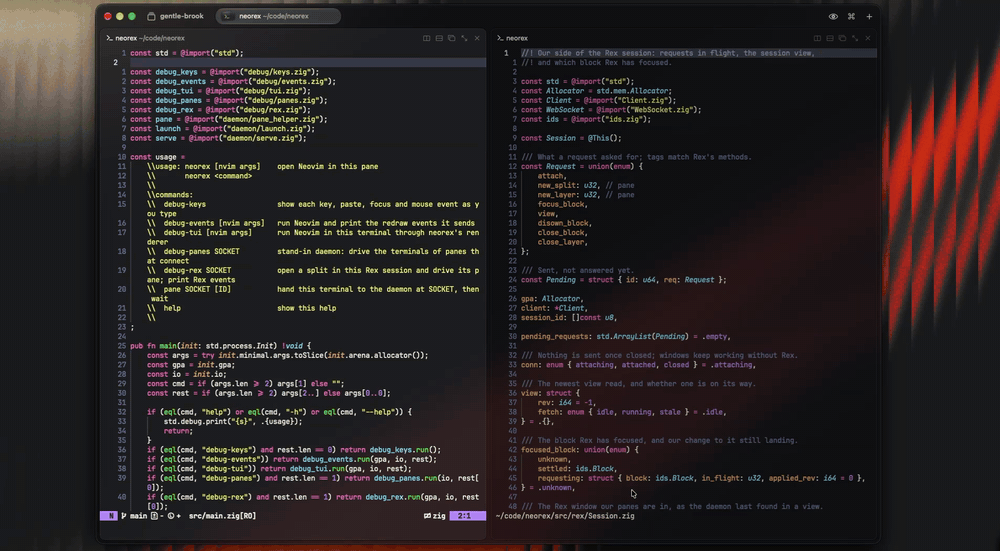

# neorex

A Rex-Native Neovim frontend built in Zig.

One Neovim runs in the background behind all your panes, so buffers,
registers, undo and language servers are shared. `:split` and `:vsplit` open
real Rex panes where Neovim would put the window, and closing a pane in Rex
closes its window. A popup is drawn either in the focused pane or in a Rex
floating pane. Floats on the whole editor that you go into, such as pickers,
and ones you can't go into, such as which-key and notifications, open in Rex
floating panes, along with any floats attached to them. The completion menu,
floats at the cursor or on a window, and statuslines are drawn inside the pane
they belong to.



## Status

Very early and rough, bugs / missing features are to be expected.

AI has been used heavily in building neorex due to limits on my available time. A lot of the code needs large improvements, cleanup, better design etc. I will be doing this incrementally - any contributions are welcome.

## Requirements

- macOS or Linux
- [Rex](https://www.superlogical.com/rex), with its setting to auto-balance
  splits turned off if you want layouts driven by Neovim. Otherwise Rex evens
  out every new split, so a sidebar such as neo-tree opens at half the window
  instead of its own width.
- A recent Neovim. It's developed against 0.13-dev; older versions may show
  no statuslines.
- Zig 0.17 to build from source

## Install

Download the latest release for your OS and architecture (macOS or Linux,
x86_64 or arm64):

```sh
curl -fsSL https://raw.githubusercontent.com/alexrlocke/neorex/main/install.sh | sh
```

This puts neorex in `~/.local/share/neorex` and links it from
`~/.local/bin/neorex`. Or download a tarball from the
[releases page](https://github.com/alexrlocke/neorex/releases) yourself.

Release tarballs are signed with [minisign](https://jedisct1.github.io/minisign/).
The install script checks the signature when minisign is installed. To check
a tarball you downloaded yourself:

```sh
minisign -Vm neorex-aarch64-macos.tar.gz -P RWSx8dufrslQk2iEQLeMJnfJIR4h1mg8j6JDo9UBbyzcQIF4cjAA6Z4w
```

### Nix

The flake builds neorex from source for Linux and Apple Silicon Macs:

```sh
nix run github:alexrlocke/neorex             # try it
nix profile install github:alexrlocke/neorex # install it
```

Or add it as a flake input:

```nix
inputs.neorex = {
  url = "github:alexrlocke/neorex";
  inputs.nixpkgs.follows = "nixpkgs"; # reuse your nixpkgs instead of a second copy
};
```

then either use
`inputs.neorex.packages.${pkgs.stdenv.hostPlatform.system}.default`, or add
`inputs.neorex.overlays.default` to your nixpkgs overlays and use
`pkgs.neorex`.

neorex uses the `nvim` on your `PATH`.

## Build from source

```sh
zig build
zig build test
zig build test -Dgolden   # also the golden tests; downloads Ghostty once
```

The golden tests check every frame neorex draws against
[Ghostty](https://github.com/ghostty-org/ghostty)'s terminal emulator, pinned
to one commit.

Run it in a Rex pane, with any Neovim arguments:

```sh
zig-out/bin/neorex some/file.txt
```

`neorex help` lists the debug commands, which run each layer on its own:
keys, Neovim's redraw events, the renderer, and pane hand-off.

## Following Rex's theme

neorex keeps Neovim in step with Rex's theme:

- **Light and dark.** neorex asks Rex to report theme changes (mode 2031)
  and sets `'background'` to match, which reloads your colorscheme. Set
  `vim.g.neorex_follow_theme = false` to keep `'background'` as you set it.
- **Palette colors.** A highlight with only `ctermfg`/`ctermbg` (no RGB
  color) is drawn as that palette color, so Rex fills it in from its current
  theme and it changes when the theme does. Highlights with RGB colors are
  drawn as before.
- **Accent.** neorex asks Rex for the theme's cursor color (OSC 21) and sets
  `vim.g.neorex_accent` to it, as `"#rrggbb"`, or to nil when the theme has
  none. It asks again after each theme change and, while the pane doesn't
  have focus, as when Rex's theme picker is open, every few hundredths of a
  second, so the accent follows the picker's previews.

`runtime/` has a colorscheme and a lualine theme, both named `neorex`, made
of the 16 palette colors and the accent, so Neovim takes on Rex's colors
exactly. The accent colors the Normal-mode statusline, and blue stands in for
it when there is none.
neorex installs them beside its binary, in `share/neorex/runtime`, and adds
them to Neovim's `'runtimepath'` itself, so inside neorex `:colorscheme neorex`
works with no setup. Before your `init.lua` runs, neorex also sets
`vim.g.neorex = true`, so your config can use them only when Neovim runs in
neorex (lazy.nvim / LazyVim shown):

```lua
-- set by neorex before init.lua runs
local in_neorex = vim.g.neorex == true

return {
  { "LazyVim/LazyVim", opts = { colorscheme = in_neorex and "neorex" or nil } },
  {
    "nvim-lualine/lualine.nvim",
    opts = function(_, opts)
      if not in_neorex then return end
      opts.options.theme = "neorex"
      -- the theme's middle section has no background, so drop the separator glyphs
      opts.options.section_separators = { left = "", right = "" }
    end,
  },
}
```

lazy.nvim rebuilds `'runtimepath'` in `setup()`, which drops the folder neorex
added. neorex also sets `vim.g.neorex_runtime` to that folder, so tell
lazy.nvim to keep it:

```lua
require("lazy").setup({
  -- spec = ...,
  performance = { rtp = { paths = { vim.g.neorex_runtime } } },
})
```

Outside neorex `vim.g.neorex_runtime` is unset, and this adds nothing.
Configs that detect neorex from its socket name (`vim.v.servername`) keep
working.

With mini.statusline instead of lualine, the colorscheme alone is enough: it
gives mini.statusline the same colors as the lualine theme.

Plugins that set their own RGB colors keep them.

To use the accent elsewhere, link to the `NeorexAccent` highlight group,
which the `neorex` colorscheme keeps up to date, or read
`vim.g.neorex_accent` when the `User NeorexAccent` event fires:

```lua
vim.api.nvim_create_autocmd("User", {
  pattern = "NeorexAccent",
  callback = function()
    vim.api.nvim_set_hl(0, "CursorLineNr", { fg = vim.g.neorex_accent, bold = true })
  end,
})
```

## Pickers in Rex's command palette

neorex can optionally use Rex's native pickers and inputs:
`vim.ui.select` (LSP code actions and many plugins), `vim.ui.input` (LSP
rename), a set of pickers (files, grep, LSP, diagnostics and more), and lists
of your own. Each can be enabled in your Neovim config and is not used by
default.

Rex only lets an action from its own config use its prompts, so this needs one
line in Rex's config, `~/.config/rex/init.lua`:

```lua
pcall(dofile, os.getenv("HOME") .. "/.local/state/neorex/rex.lua")
```

neorex writes that file each time it starts and has Rex reload it when it
changes, so it always matches the neorex you run. `:checkhealth neorex` says
whether Rex loads it and whether an app is connected to show prompts.

The `vim.ui` replacements are off until you turn them on. Outside neorex this
does nothing, so it needs no `if`:

```lua
vim.g.neorex_config = { ui = { select = "rex", input = "rex" } }
```

This takes precedence over plugins that replace `vim.ui.select` as Neovim
starts, such as snacks.nvim's picker, which then asks when no Rex app can. A
replacement made later, after startup, is left alone. To change the options
while Neovim runs, call `neorex.configure({ ... })`.

Map the pickers you want in Rex. They use snacks.nvim's picker names, so
moving a key over means changing `Snacks.picker.<name>` to
`pick.<name>`:

```lua
if vim.g.neorex then
  local pick = require("neorex.pick")
  vim.keymap.set("n", "<leader>ff", pick.files)
  vim.keymap.set("n", "<leader>fb", pick.buffers)
  vim.keymap.set("n", "<leader>sg", pick.grep)
  vim.keymap.set("n", "grr", pick.lsp_references)
end
```

| Picker | Lists | Choosing one |
|---|---|---|
| `files` | git's files, or ripgrep's outside a repository; `files({ cmd = { "fd", "--type", "f", "--hidden" } })` lists with your own command | opens it |
| `git_files` | files git tracks | opens it |
| `git_status` | changed and untracked files, with their status | opens it |
| `recent` | `v:oldfiles` that still exist | opens it |
| `buffers` | listed buffers | goes to it |
| `grep` | asks what to search for, then lists the matches (ripgrep, else `git grep`) | goes to it |
| `grep_word` | matches for the word under the cursor | goes to it |
| `lines` | the buffer's lines | goes to it |
| `lsp_definitions`, `lsp_declarations`, `lsp_type_definitions` | as `vim.lsp.buf`'s: a single result is gone to without asking | goes to it |
| `lsp_references`, `lsp_implementations` | as `vim.lsp.buf`'s | goes to it |
| `lsp_symbols` | the buffer's symbols | goes to it |
| `lsp_workspace_symbols` | asks for a query, then lists matching symbols | goes to it |
| `diagnostics`, `diagnostics_buffer` | every buffer's, or this buffer's, errors first | goes to it |
| `qflist`, `loclist` | the quickfix or location list | goes to it |
| `marks` | marks a-z, A-Z and 0-9 | goes to it |
| `jumps` | the jumplist, most recent first | goes to it |
| `registers` | registers that hold something | puts it after the cursor |
| `command_history` | commands run before | runs it again |
| `search_history` | searches made before | searches again |
| `commands` | Ex commands | runs a user command that takes no arguments; starts typing any other |
| `colorschemes` | installed colorschemes | applies it |

Going to a location leaves a mark in the jumplist, and the LSP pickers put
where you came from on the tag stack, so `CTRL-T` goes back. Grep asks for
the whole query, then lists the matches: Rex's palette can't search as you
type, or preview. Rex shows at most 2,000 items and takes at most 1 MiB in one
question, which only very long rows fill first. A longer list asks for part of
a name first, then lists what matches; if that is still too many, it lists the
first that fit, and its title says how many, such as "Files: model (first 2000
of 2500)".

For a list of your own, call `require("neorex.ui").select`. It takes
`vim.ui.select`'s arguments, and `opts.rex` adds what only Rex shows:
`title`, `subtitle` and `detail` (functions of an item), `icon`, `placeholder`,
`multiple` (choose several: the callback gets a list) and `allow_other`
(answer with typed text).

If no connected Rex app can show a prompt, Neovim asks instead. Anything else
that stops Rex asking, such as Rex already asking something or its config not
loading neorex's actions, shows a message and asks nothing.

## Current limitations

- The `<C-w>` resize, swap and move commands do nothing. Use Rex's own pane
  controls instead. This is intentional for now: I recommend using Rex's window
  management commands, which I find are just better than Neovim's.
- Plugins that arrange windows (sidebars, layout managers) don't get the
  placement they expect: Rex decides where panes go (see above).
- Only one tab page: Neovim tab pages aren't Rex tabs (for now...).
- No external command line or messages: long messages still show
  "Press ENTER".
- No global statusline: neorex sets `laststatus=3` to `2`, so each pane shows
  its own window's statusline. Neovim draws none on neorex's windows with `3`.
- The accent is an RGB color, so it changes only once neorex has asked for it
  again, not with the palette. When Rex's app runs on another machine than
  neorex, it lags the rest of the theme by about one network round trip.

## Plans

Much of neorex will be split out into standalone Zig modules, and later into
their own packages:

- a Neovim RPC client (msgpack, message framing, requests)
- a Rex API client (WebSocket and the control protocol)
- terminal key input (the kitty keyboard protocol)

neorex should then be easier to extend to other editors that provide similar processes for running external windows.

## License

MIT
