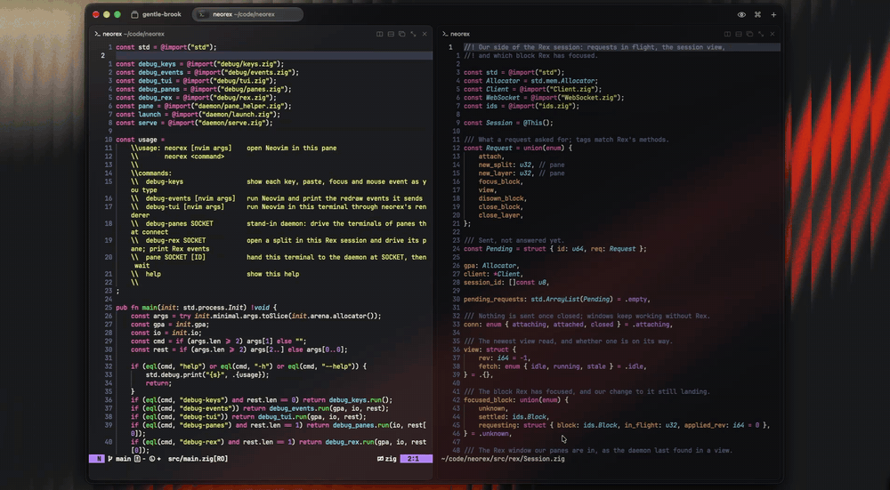

# neorex

A Rex-Native Neovim frontend built in Zig.

One Neovim runs in the background behind all your panes, so buffers,
registers, undo and language servers are shared. `:split` and `:vsplit` open
real Rex panes where Neovim would put the window, and closing a pane in Rex
closes its window. Focusable floats, such as pickers, open in Rex floating
panes, along with any floats attached to them. The completion menu,
unfocusable floats like notifications, and statuslines are drawn inside the
pane they belong to.



## Status

Very early and rough, bugs / missing features are to be expected.

AI has been used heavily in building neorex due to limits on my available time. A lot of the code needs large improvements, cleanup, better design etc. I will be doing this incrementally - any contributions are welcome.

## Requirements

- macOS or Linux
- [Rex](https://www.superlogical.com/rex), with its setting to auto-balance
  splits turned off. Otherwise Rex evens out every new split, so a sidebar
  such as neo-tree opens at half the window instead of its own width.
- A recent Neovim. It's developed against 0.13-dev; older versions may show
  no statuslines.
- Zig 0.17 to build from source

## Install

Download the latest release for your OS and architecture (macOS or Linux,
x86_64 or arm64):

```sh
curl -fsSL https://raw.githubusercontent.com/alexrlocke/neorex/main/install.sh | sh
```

This puts neorex in `~/.local/share/neorex` and links it from
`~/.local/bin/neorex`. The colorscheme and lualine theme described below are
in `~/.local/share/neorex/runtime`. Or download a tarball from the
[releases page](https://github.com/alexrlocke/neorex/releases) yourself.

Release tarballs are signed with [minisign](https://jedisct1.github.io/minisign/).
The install script checks the signature when minisign is installed. To check
a tarball you downloaded yourself:

```sh
minisign -Vm neorex-aarch64-macos.tar.gz -P RWSx8dufrslQk2iEQLeMJnfJIR4h1mg8j6JDo9UBbyzcQIF4cjAA6Z4w
```

### Nix

The flake builds neorex from source for Linux and Apple Silicon Macs:

```sh
nix run github:alexrlocke/neorex             # try it
nix profile install github:alexrlocke/neorex # install it
```

Or add it as a flake input:

```nix
inputs.neorex = {
  url = "github:alexrlocke/neorex";
  inputs.nixpkgs.follows = "nixpkgs"; # reuse your nixpkgs instead of a second copy
};
```

then either use
`inputs.neorex.packages.${pkgs.stdenv.hostPlatform.system}.default`, or add
`inputs.neorex.overlays.default` to your nixpkgs overlays and use
`pkgs.neorex`.

The colorscheme and lualine theme are in the package's
`share/neorex/runtime`. neorex uses the `nvim` on your `PATH`.

## Build from source

```sh
zig build
zig build test
zig build test -Dgolden   # also the golden tests; downloads Ghostty once
```

The golden tests check every frame neorex draws against
[Ghostty](https://github.com/ghostty-org/ghostty)'s terminal emulator, pinned
to one commit.

Run it in a Rex pane, with any Neovim arguments:

```sh
zig-out/bin/neorex some/file.txt
```

`neorex help` lists the debug commands, which run each layer on its own:
keys, Neovim's redraw events, the renderer, and pane hand-off.

## Following Rex's theme

neorex keeps Neovim in step with Rex's theme:

- **Light and dark.** neorex asks Rex to report theme changes (mode 2031)
  and sets `'background'` to match, which reloads your colorscheme. Set
  `vim.g.neorex_follow_theme = false` to keep `'background'` as you set it.
- **Palette colors.** A highlight with only `ctermfg`/`ctermbg` (no RGB
  color) is drawn as that palette color, so Rex fills it in from its current
  theme and it changes when the theme does. Highlights with RGB colors are
  drawn as before.

`runtime/` has a colorscheme and a lualine theme, both named `neorex`, made
only of the 16 palette colors, so Neovim takes on Rex's colors exactly. To
use them only when Neovim runs in neorex (lazy.nvim / LazyVim shown):

```lua
-- neorex starts Neovim with `--listen $TMPDIR/neorex-<pid>.nvim.sock`
local in_neorex = vim.v.servername:match("/neorex%-%d+%.nvim%.sock$") ~= nil
if in_neorex then
  vim.opt.rtp:append("/path/to/neorex/runtime")
end

return {
  { "LazyVim/LazyVim", opts = { colorscheme = in_neorex and "neorex" or nil } },
  {
    "nvim-lualine/lualine.nvim",
    opts = function(_, opts)
      if not in_neorex then return end
      opts.options.theme = "neorex"
      -- the theme's middle section has no background, so drop the separator glyphs
      opts.options.section_separators = { left = "", right = "" }
    end,
  },
}
```

Plugins that set their own RGB colors keep them.

## Current limitations

- The `<C-w>` resize, swap and move commands do nothing. Use Rex's own pane
  controls instead.
- Plugins that arrange windows (sidebars, layout managers) don't get the
  placement they expect.
- Only one tab page: Neovim tab pages aren't Rex tabs.
- No external command line or messages: long messages still show
  "Press ENTER".
- No global statusline: with `laststatus=3`, each pane still shows its own
  statusline.

## Plans

Much of neorex will be split out into standalone Zig modules, and later into
their own packages:

- a Neovim RPC client (msgpack, message framing, requests)
- a Rex API client (WebSocket and the control protocol)
- terminal key input (the kitty keyboard protocol)

neorex should then be easier to extend to other editors that provide similar processes for running external windows.

## License

MIT
