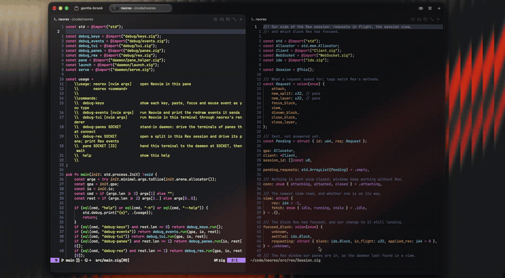

# neorex

A Rex-Native Neovim frontend built in Zig.

One Neovim runs in the background behind all your panes, so buffers,
registers, undo and language servers are shared. `:split` and `:vsplit` open
real Rex panes where Neovim would put the window, and closing a pane in Rex
closes its window. Focusable floats, such as pickers, open in Rex floating
panes, along with any floats attached to them. The completion menu,
unfocusable floats like notifications, and statuslines are drawn inside the
pane they belong to.



## Status

Very early and rough, bugs / missing features are to be expected.

AI has been used heavily in building neorex due to limits on my available time. A lot of the code needs large improvements, cleanup, better design etc. I will be doing this incrementally - any contributions are welcome.

## Requirements

- macOS (it uses kqueue)
- [Rex](https://www.superlogical.com/rex)
- A recent Neovim. It's developed against 0.13-dev; older versions may show
  no statuslines.
- Zig 0.17 to build

## Build and run

```sh
zig build
zig build test
zig build test -Dgolden   # also the golden tests; downloads Ghostty once
```

The golden tests check every frame neorex draws against
[Ghostty](https://github.com/ghostty-org/ghostty)'s terminal emulator, pinned
to one commit.

Run it in a Rex pane, with any Neovim arguments:

```sh
zig-out/bin/neorex some/file.txt
```

`neorex help` lists the debug commands, which run each layer on its own:
keys, Neovim's redraw events, the renderer, and pane hand-off.

## Current limitations

- The `<C-w>` resize, swap and move commands do nothing. Use Rex's own pane
  controls instead.
- Plugins that arrange windows (sidebars, layout managers) don't get the
  placement they expect.
- Only one tab page: Neovim tab pages aren't Rex tabs.
- No external command line or messages: long messages still show
  "Press ENTER".
- No global statusline: with `laststatus=3`, each pane still shows its own
  statusline.

## Plans

Much of neorex will be split out into standalone Zig modules, and later into
their own packages:

- a Neovim RPC client (msgpack, message framing, requests)
- a Rex API client (WebSocket and the control protocol)
- terminal key input (the kitty keyboard protocol)

neorex should then be easier to extend to other editors that provide similar processes for running external windows.

## License

MIT
